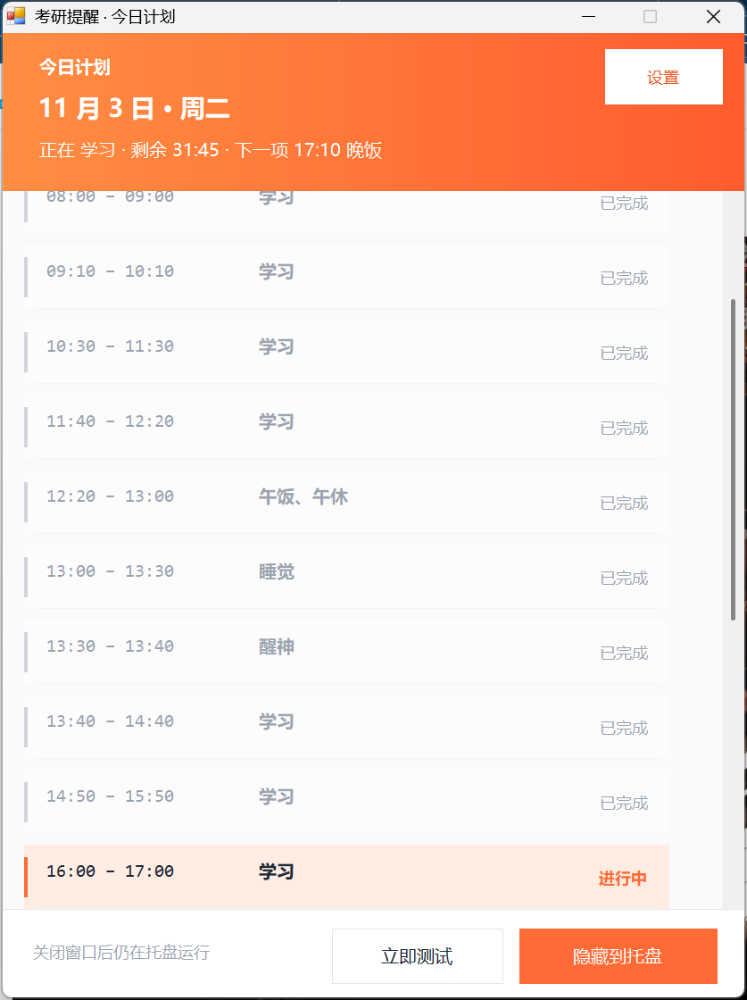
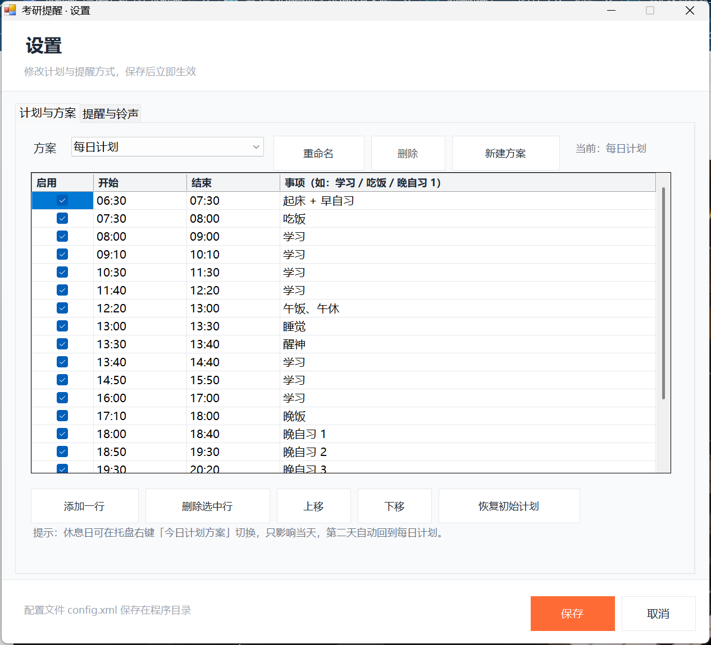

# 考研提醒 · KaoYan Reminder

一个轻量的 **Windows 桌面提醒工具**，按照你自定义的每日计划，在时间点自动弹窗、响铃、可选中文语音播报；桌面常驻一条倒计时条，随时显示“当前在做什么、还剩多久、下一项是什么”。

适合考研、考公、考证、自习等需要严格时间管理的场景。

| 今日计划 | 到点提醒 |
| --- | --- |
|  |  |

| 桌面倒计时条 | 设置 |
| --- | --- |
|  |  |

> 截图均为 Windows 11 150% 缩放下的真实运行界面。

## 功能

- **到点自动提醒**：开始时间弹大卡片 + 循环铃声，点「知道了」停止；可以「5 分钟后再提醒」。
- **结束轻提醒**：每个时间段结束时弹右下角小提示 + 短提示音，5 秒自动消失，可选关闭。
- **自定义铃声**：支持电脑里的 `.wav` / `.mp3` / `.wma`，可试听、可循环、可设置最长响铃秒数；播放失败会自动回退到系统铃声。
- **中文语音播报**：开始提醒时播报“现在是 9 点 10 分，学习，开始吧”，可选语音、可试听；没有中文语音包时自动只响铃。
- **桌面常驻倒计时条**：显示当前任务剩余时间和下一项预告，可拖动、自动记住位置、可隐藏；右键可暂停/设置/打开今日计划。
- **今日计划窗口**：当前任务高亮、已完成置灰、显示剩余时间；关闭窗口不退出，程序继续在托盘运行。
- **自定义计划**：表格增删改、上下移、启用/停用；支持多套方案（默认「每日计划」+ 可新建「休息日计划」），托盘切换只影响当天，第二天自动恢复每日计划。
- **补提醒**：程序晚开一两分钟仍会补提醒（默认 2 分钟宽限）。
- **托盘常驻**：单实例运行、随手暂停 30 分钟、开机自启（写 `HKCU`，不需要管理员）。
- **本地运行**：不联网、不上传数据；配置和日志只保存在程序所在目录。

## 快速开始

### 直接使用

1. 下载 [`dist/考研提醒.exe`](dist/考研提醒.exe)。
2. 双击运行，屏幕右下角会出现橙色闹钟托盘图标和桌面倒计时条。
3. 右键托盘图标 →「立即测试提醒」，确认弹窗、铃声、语音正常。
4. 需要开机自启：右键托盘图标 →「开机自动启动」。

> 程序需要 Windows 10/11 和系统自带的 .NET Framework 4.x，无需安装 Python/Node 等环境。

### 从源码编译

环境：Windows + .NET Framework 4.x（系统自带 `csc.exe`）。

```powershell
git clone https://github.com/haztbye/reminder.git
cd kaoyan-reminder
powershell -NoProfile -ExecutionPolicy Bypass -File .\src\build.ps1
```

编译产物：`dist\考研提醒.exe`。

源码结构：

```
src/
  Program.cs            入口、单实例、命令行参数
  AppConfig.cs          配置模型、默认计划、XML 读写
  ScheduleEngine.cs     调度核心（开始/结束/暂停/稍后/宽限）
  AudioService.cs       铃声（wav/mp3）+ 中文 TTS
  TrayApp.cs            托盘、定时循环、方案切换、自启
  MainForm.cs           今日计划窗口
  ReminderForm.cs       到点提醒 / 结束轻提醒
  CountdownBar.cs       桌面倒计时条（可拖动）
  SettingsForm.cs       设置界面（计划/铃声/语音）
  UiTheme.cs, UiScale.cs, AppPaths.cs
  app.ico, app.manifest, build.ps1, make_icon.ps1
```

## 使用说明

完整中文说明（计划编辑、休息日方案、铃声/语音设置、常见问题、默认计划表）见 [使用说明.md](使用说明.md)。

几个高频操作：

| 想做什么 | 怎么做 |
| --- | --- |
| 修改计划时间/事项 | 托盘右键 →「设置提醒…」→ 计划与方案 → 保存 |
| 休息日换计划 | 设置里新建方案 → 托盘右键「今日计划方案」→ 选择，次日自动回默认 |
| 临时不被打扰 | 托盘右键 →「暂停提醒 30 分钟」 |
| 换铃声/关语音 | 设置 → 提醒与铃声 |
| 查看今日安排 | 双击托盘图标，或右键「打开今日计划」 |
| 完全退出 | 托盘右键 →「退出考研提醒」 |

## 默认计划

首次运行会预置一份 06:30 → 23:00 的考研作息表（20 项，含起床、三餐、学习、午休、晚自习、复盘、睡觉），可直接用，也可以在设置里随意修改。

默认另附一份「休息日计划」（初始内容与每日计划相同，可自行调整后使用）。

## 配置与隐私

- 设置、计划数据：程序目录下 `config.xml`（首次运行自动生成）。
- 运行日志：程序目录下 `提醒日志.txt`。
- 不会写入 C 盘其他位置；不发起任何网络请求；不收集任何数据。
- 只有勾选「开机自动启动」时，才会写入当前用户注册表：
  `HKCU\Software\Microsoft\Windows\CurrentVersion\Run`。

## 已知限制

- **电脑关机或睡眠时无法提醒**——这是桌面软件的限制，任何普通桌面程序都叫不醒关机/睡眠中的电脑；建议早上另设手机闹钟兜底。
- 计划按“每天”重复；不同日子（如休息日）通过多方案手动切换。
- 设置窗口按 150% 缩放设计，在 1920×1080@150% 等较小工作区上可能超出屏幕底部；普通 2K/1080p@100% 屏幕没问题。
- 无结束时间的最后一项（例如 23:00 上床睡觉）过点后，今日计划里的状态仍显示“待开始”（仅显示问题，不影响提醒）。
- 程序为本地编译、无数字签名，个别杀毒软件可能提示风险；源码完全公开，可自行编译。

## English Summary

**KaoYan Reminder** is a lightweight Windows tray app for daily study schedules. It shows a pop-up reminder with a looping ringtone and optional Chinese text-to-speech at each scheduled time, keeps a small always-on-top countdown bar on the desktop, and includes a lightweight plan editor with multiple plan profiles (e.g. weekday/rest-day).

- Windows 10/11, no installer, no external runtime required (.NET Framework 4.x built in).
- Local only: no network access, no telemetry; config and logs live next to the executable.
- Build from source: `powershell -NoProfile -ExecutionPolicy Bypass -File .\src\build.ps1`.
- License: MIT.

## License

[MIT](LICENSE)